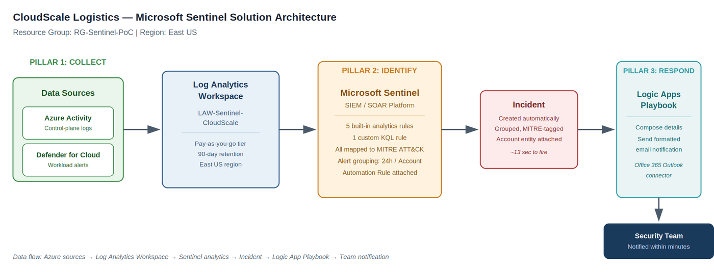
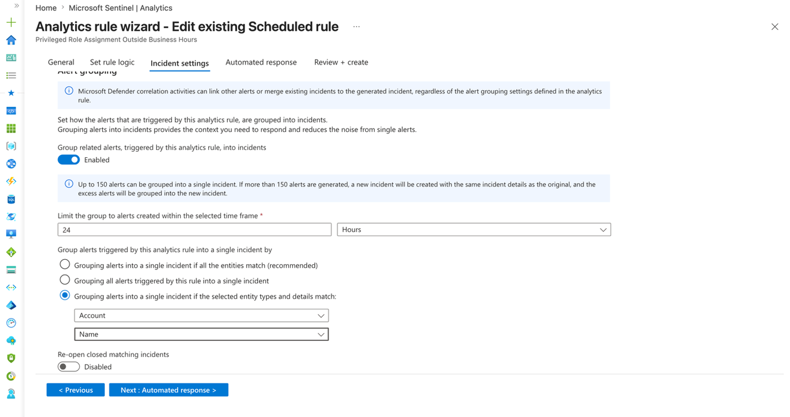
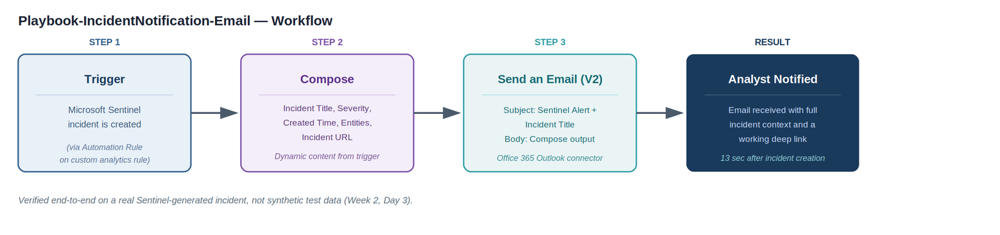
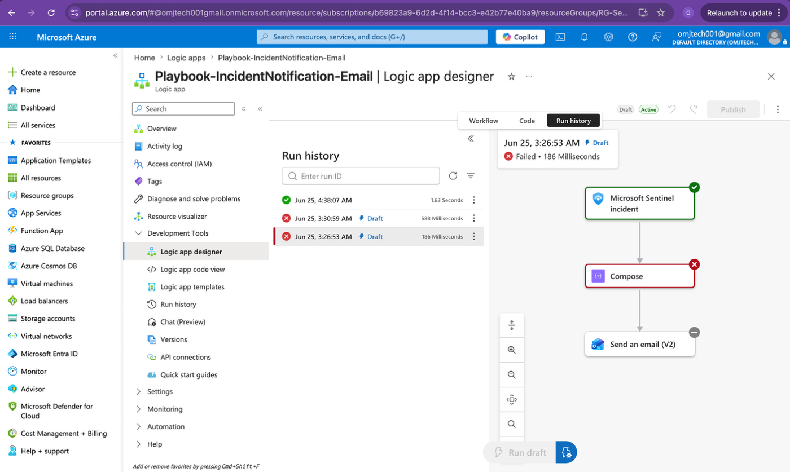
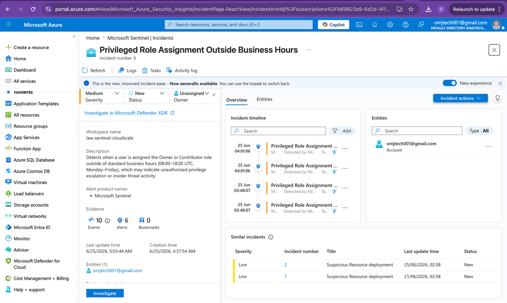
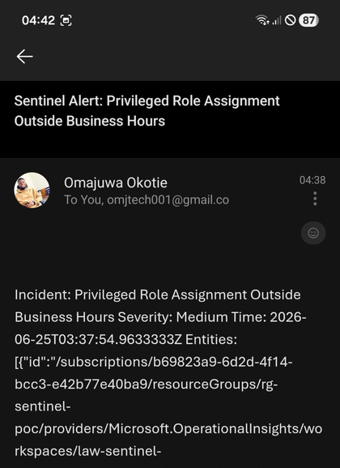

# Cloud Threat Detection and Automated Response with Microsoft Sentinel


A two-week Microsoft Sentinel proof of concept for a logistics company with no unified security visibility and a four-hour response time to a suspected credential compromise. I centralised Azure telemetry in a Log Analytics workspace, enabled analytics rules, wrote and debugged a custom KQL detection for privilege escalation outside business hours, and automated incident notification with a Logic Apps playbook.

**Result: from role assignment to a delivered alert in under five minutes, with the playbook firing 13 seconds after the incident was created, verified against a real event, not a synthetic payload.**

📄 **[Read the full report (PDF, 22 pages)](cloudscale-sentinel.pdf)**

---

## Contents

- [The brief](#the-brief)
- [Highlights](#highlights)
- [Architecture](#architecture)
- [Detection engineering](#detection-engineering)
- [Debugging the custom rule](#debugging-the-custom-rule)
- [Automated response](#automated-response)
- [End-to-end validation](#end-to-end-validation)
- [Results against success metrics](#results-against-success-metrics)
- [Tech stack](#tech-stack)
- [Recommended next steps](#recommended-next-steps)
- [Lessons learned](#lessons-learned)
- [Author](#author)

---

## The brief

| | |
| --- | --- |
| **Client brief** | CloudScale Logistics: a mid-market freight and supply chain company with 200+ enterprise clients |
| **Engagement** | Microsoft Sentinel SIEM and SOAR, two-week proof of concept |
| **Platform** | Microsoft Azure, East US |
| **Frameworks** | NIST Cybersecurity Framework, MITRE ATT&CK, SOC 2 Type II, ISO 27001 |

CloudScale had moved its freight tracking, inventory, customer portal and payment processing to Azure over eighteen months, while its small team (two analysts and a part-time CISO) remained skilled mainly in on-premises infrastructure. Three problems followed:

- **No unified visibility.** Activity logs, Defender alerts and VM events lived in separate places, so an attacker could move between subscriptions without raising a timely alert.
- **Slow, manual response.** A suspected credential compromise in the payment-processing subscription took **over four hours** to reach a response decision.
- **An audit gap.** ISO 27001 auditors raised a non-conformance because the company could not show a documented detection and response process for its cloud systems.

> This was a portal-based engagement (Sentinel, Log Analytics, KQL and Logic Apps), not an infrastructure-as-code build. The value is in the detection engineering, the debugging and the validated automation.

---

## Highlights

- **Detection to notification cut from 4+ hours to under 5 minutes**, with the playbook firing **13 seconds** after incident creation.
- **A custom KQL rule that failed silently, diagnosed and fixed** through live testing: a case-sensitivity bug and a field that never contains the value the rule was filtering on.
- **Alert grouping working as designed:** 6 alerts and 10 events from the same account consolidated into **one incident**.
- **A platform limitation found and worked around:** the Gmail connector is blocked alongside a Sentinel trigger, so the playbook was moved to Office 365 Outlook.
- **Tested with a real role assignment**, after two hand-written test payloads failed to match Sentinel's real incident schema.

---

## Architecture

Three pillars mapped to the **Detect** and **Respond** functions of the NIST Cybersecurity Framework: collect the data, identify the threats, respond automatically.



| Component | Role |
| --- | --- |
| Log Analytics workspace (`LAW-Sentinel-CloudScale`) | Central store and query engine for all security telemetry, with 90-day retention |
| Microsoft Sentinel | SIEM and SOAR layer: analytics rules, incidents and playbooks |
| Azure Activity logs | Control-plane data source: who did what, when and from where |
| Microsoft Defender for Cloud (Foundational CSPM) | Workload alerts, mapped to MITRE ATT&CK |
| Azure Logic Apps | Automation engine behind the notification playbook |
| KQL | Detection rules and data ingestion checks |

Everything was deployed into one resource group (`RG-Sentinel-PoC`) to keep cost tracking and clean-up simple.


---

## Detection engineering

Six analytics rules were enabled: five built-in rules (brute-force authentication, anomalous resource deletions, rare subscription-level operations, suspicious resource deployment and Entra ID PowerShell misuse) and **one custom rule** written for this client's real risk: an insider or compromised account quietly granting itself high privilege outside business hours.

**The deployed custom rule:**

```kql
AzureActivity
| where OperationNameValue =~ "Microsoft.Authorization/roleAssignments/write"
| where ActivityStatusValue == "Success"
| extend Hour = hourofday(TimeGenerated)
| extend DayOfWeek = dayofweek(TimeGenerated)
| where Hour < 8 or Hour > 18 or DayOfWeek == 0d or DayOfWeek == 6d
| project TimeGenerated, Caller, ResourceGroup, SubscriptionId
```

Runs every 5 minutes over the last hour, severity Medium, mapped to MITRE ATT&CK **Privilege Escalation**, with the `Caller` mapped as an Account entity.


**Alert grouping:** related alerts for the same account within **24 hours** are grouped into a single incident, so analysts see one story instead of a stream of duplicates.



---

## Debugging the custom rule

The first version of the rule never fired. Testing it against a real role assignment found two separate problems:

| | First version | Problem | Fix |
| --- | --- | --- | --- |
| **Operation match** | `==` (case-sensitive) | Azure stores the operation in uppercase (`MICROSOFT.AUTHORIZATION/ROLEASSIGNMENTS/WRITE`), so the match silently failed | `=~` (case-insensitive) |
| **Role filter** | `Role contains "Owner" or Role contains "Contributor"` | `AzureActivity` never records the role's friendly name for this operation, only a GUID for that single assignment, so the filter could never match real data | Detect any successful role assignment outside business hours |

**The first version, for comparison:**

```kql
AzureActivity
| where OperationNameValue == "Microsoft.Authorization/roleAssignments/write"
| where ActivityStatusValue == "Success"
| extend Role = tostring(parse_json(Properties).role)
| where Role contains "Owner" or Role contains "Contributor"
| extend Hour = hourofday(TimeGenerated)
| extend DayOfWeek = dayofweek(TimeGenerated)
| where Hour < 8 or Hour > 18 or DayOfWeek == 0d or DayOfWeek == 6d
| project TimeGenerated, Caller, Role, ResourceGroup, SubscriptionId
```

A rule that never fires looks exactly like a quiet, safe environment. That is why it was tested against a real event before being trusted.

**Recommended production version** (designed, not yet deployed): restore role-specific scope by matching the built-in role definition GUIDs for Owner, Contributor and User Access Administrator. See Appendix A of the [full report](cloudscale-sentinel.pdf).

```kql
// Owner, Contributor, User Access Administrator
AzureActivity
| where OperationNameValue =~ "Microsoft.Authorization/roleAssignments/write"
| where ActivityStatusValue == "Success"
| where Properties has "8e3af657-a8ff-443c-a75c-2fe8c4bcb635"
    or Properties has "b24988ac-6180-42a0-ab88-20f7382dd24c"
    or Properties has "18d7d88d-d35e-4fb5-a5c3-7773c20a72d9"
| extend Hour = hourofday(TimeGenerated)
| extend DayOfWeek = dayofweek(TimeGenerated)
| where Hour < 8 or Hour > 18 or DayOfWeek == 0d or DayOfWeek == 6d
| project TimeGenerated, Caller, CallerIpAddress, OperationNameValue, ResourceGroup, SubscriptionId
| sort by TimeGenerated desc
```

---

## Automated response

The Logic App playbook `Playbook-IncidentNotification-Email` triggers when Sentinel creates an incident, composes a summary (title, severity, time, entities and a deep link to the incident) and emails the security team.



**Two failures fixed on the way:**

- **Gmail connector blocked.** The first version used Gmail and failed with `GmailConnectorPolicyViolation`: Microsoft does not allow the Gmail connector in the same workflow as a Sentinel incident trigger. Switched to Office 365 Outlook **Send an email (V2)**.
- **Synthetic test payloads rejected.** Two hand-written JSON payloads could not be guaranteed to match Sentinel's real incident schema, so the final test used a real incident.

The run history shows both failed draft runs and the successful run against the real incident:



---

## End-to-end validation

A single controlled test exercised every stage, starting from a **real Owner role assignment**:

| Stage | Result | Evidence |
| --- | --- | --- |
| Role assigned | Owner role granted to a test account, 03:01:06 UTC | `AzureActivity` row |
| Rule fired | Custom rule matched within one run cycle | Alert in Logs and rule run history |
| Incident created | One incident, with **6 alerts and 10 events** grouped | Incident #3, 04:37:54 UTC |
| Playbook ran | All steps succeeded in 1.63 seconds | Run at 04:38:07 UTC, **13 s after the incident** |
| Team notified | Formatted email with a working deep link | Received around 04:42 UTC |

| Incident with grouped alerts | Email received by the team |
| --- | --- |
|  |  |

Against the starting point of more than four hours to a response decision, the whole chain completed in **under five minutes**.

---

## Results against success metrics

| Metric | Target | Outcome |
| --- | --- | --- |
| Centralised visibility | 100% of admin actions queryable within 15 minutes | ✅ Met |
| Custom detection | Privilege escalation rule fires on simulation | ✅ Met, after the case-sensitivity and role-field fixes |
| Automated notification | Playbook fires within 2 minutes of an incident | ✅ Met, 13 seconds observed |
| Audit retention | Telemetry retained for at least 90 days | ✅ Met |
| Analytics coverage | 10+ rules mapped to MITRE ATT&CK | ⚠️ Partially met: 6 of 10 enabled |

The audit gap is addressed by a documented, tested detection and response process, with evidence retained for 90 days.

---

## Tech stack

| Area | Tools |
| --- | --- |
| SIEM and SOAR | Microsoft Sentinel |
| Data | Log Analytics, Azure Activity logs, Microsoft Defender for Cloud |
| Detection | KQL analytics rules, MITRE ATT&CK mapping, alert grouping |
| Automation | Azure Logic Apps, Office 365 Outlook connector |
| Frameworks | NIST CSF, MITRE ATT&CK, ISO 27001, SOC 2 Type II |

---

## Recommended next steps

In priority order, from the report:

1. Deploy the hardened rule that matches role definition GUIDs, restoring precise Owner and Contributor scope
2. Enable paid Defender for Cloud plans for deeper workload coverage
3. Add an automated containment action to the playbook, such as disabling a compromised account, behind an approval step
4. Enable UEBA for behavioural baselining of users, hosts and IP addresses
5. Integrate Microsoft Defender Threat Intelligence
6. Send notifications to Microsoft Teams
7. Connect Entra ID sign-in logs and Office 365, and apply 24-hour grouping to all rules
8. Move to a Sentinel commitment tier once real ingestion volume is known

---

## Lessons learned

- **A rule that never fires looks like a safe environment.** Detections must be tested against real events before they are trusted.
- **Check the data, not your assumptions about it.** The role name the rule depended on was never in the log at all.
- **Test with real events, not synthetic ones.** Hand-written payloads failed where a real incident succeeded.
- **Platform limits are part of the design.** The Gmail connector restriction was a hard limit, not a bug to work around.

---

## Author

**Omajuwa Okotie**, DevSecOps and Cloud Security Engineer

Delivered end to end from an industry client brief through AMDARI.

[Portfolio](https://omajuwaokotie.com) · [LinkedIn](https://www.linkedin.com/in/omajuwa-okotie-850950190) · [GitHub](https://github.com/omjhub)
